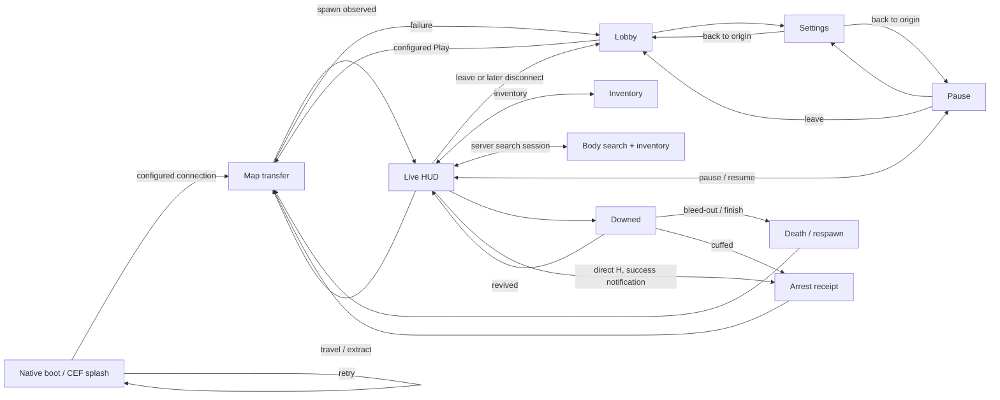

# FinalRun UI design

Implementation-ready UI handoff for the Godot client and the in-game browser. **FinalRun** uses a shared 1280 × 720 CSS-pixel frame. These files specify the screen geometry, interactions, authority, and data for boot, lobby, settings, and play.

| Start here | Covers |
|---|---|
| [Tokens](tokens.md) · [Components](components.md) | Palette, type, layout, component states and motion |
| [Flow](flow.md) · [Data contracts](DATA_CONTRACTS.md) | Routes, focus, requests, server authority and compatibility |
| [01 Splash and boot](01-splash.md) | Startup, staged progress and recovery |
| [02 Lobby](02-lobby.md) | Join, party, appearance preview and patch notes |
| [03 Settings](03-settings.md) · [Setting schema](settings-schema.json) | Four tabs and durable defaults |
| [04 HUD and overlays](04-hud.md) | Field HUD, life-state outcomes, inventory, search and pause |

## Design principles

- Leave the central sightline clear in live play. Stack optional status beside the minimap. Reserve the center for time-sensitive prompts and outcomes.
- Give each screen one clear primary action. Use amber for action, selection and focus. Keep panels quiet with three zinc surface levels, tight edge rules and local contrast.
- Show state transitions in place. Progress uses a labelled stage rail. Settings retain row position while applying. A pending party action stays with its row. Allow only one dominant life or transfer overlay.
- Use alignment and motion as feedback. Party health fills in four segments. The compass has a fixed center tick. Sliders show values as they move. A brief status transition marks a new event without flashing.
- Make state legible through text and shape. Support keyboard navigation and reduced motion. Browsers display local interaction and server snapshots. Godot owns game input and networking.

## Player flow

## How to read the specs

The linked SVGs are the geometry reference. Each has a matching ASCII frame and layout table. Right and bottom columns are insets from the 1280 × 720 frame. Parent entries identify intentional containment. Blank states use the same component bounds. Settings rows extend below their viewport in a scroller.

**EXISTS** records behavior observed in the working tree. **CHANGED** extends an existing contract. **NEW** is proposed. Section 9 in each screen records the supervisor decisions dated 2026-11-27. One remaining verification item covers the implementation two-client CEF smoke. The ImageGen concept pass informed the stage rail, layered surfaces, slider feedback, segmented health and compass treatment. Repo contracts and layout tables govern exact copy, counts and coordinates. See [Web UI](../design/WEB_UI.md), [HUD layout](../design/HUD_LAYOUT.md), [inventory](../design/INVENTORY_UI.md), [roadmap](../ROADMAP.md) and [architecture](../ARCHITECTURE.md).

Supervisor decisions retain direct boot-to-Motel connection, one configured Play action, in-game parties, session peer preferences, direct H surrender, scoped 8 s heist toast plus active line, scrollable external body rows and 900 ms receipt carry-over. Character preview follows [semi-realistic art direction](../design/ART_DIRECTION.md). The new Open Mic threshold uses design default −40 dBFS (−60–0, step 1). The implementation smoke remains open.

## Implementation order

1. Add UI tokens and contrast fixtures in `ui/web/src/styles/index.css` and `ui/web/src/styles/tokens.test.ts`.
2. Add shared controls and a focus-managed modal in `ui/web/src/lib/ui/`. Reuse existing key-hint and grid behavior where it is already shared.
3. Extend typed IPC and snapshot replay in `ui/web/src/lib/ipc/protocol.ts`, `ui/web/src/lib/ipc/bridge.ts` and `ui/hud/Hud.gd`.
4. Add the native fallback and splash in `main/Main.gd`, `ui/hud/Hud.gd`, `ui/web/src/features/splash/` and `ui/web/src/app/router.tsx`.
5. Add configured-endpoint boot/Play and reconnect in `main/Main.gd`, `ui/web/src/features/lobby/` and `ui/web/src/app/router.tsx`. Resolve `--connect host:port` in every build and keep discovery/staging flags false.
6. Add bundled news and lazy view-only preview in `ui/web/public/news.json`, `main/Main.gd` and `ui/web/src/features/lobby/`. Keep the lobby party component behind its staging capability.
7. Add settings persistence and Graphics in proposed `ui/settings/SettingsService.gd`, `main/Main.gd`, `ui/web/src/features/settings/` and `ui/web/src/app/router.tsx`.
8. Add Controls capture and approved normal hotbar 1–6/debug Ctrl+1–4/Y mapping in `main/Main.gd`, `features/player/Player.gd`, `features/player/PlayerCamera.gd` and `ui/web/src/features/settings/`. Keep B Reload and R Revive.
9. Add Social/Others session peer preferences, capability gates and English dropdown in `ui/settings/SettingsService.gd`, `ui/hud/Minimap.gd` and `ui/web/src/features/settings/`. Use the approved schema availability rule.
10. Refine live HUD in `ui/hud/Hud.gd`, `ui/hud/Minimap.gd` and `ui/web/src/features/hud/`.
11. Add life, arrest and transfer presentation in `features/downed/DownedService.gd`, `features/player/PlayerService.gd`, `features/transfer/TransferService.gd`, `main/Main.gd` and `ui/web/src/features/hud/`.
12. Finish inventory and body-search states in `ui/web/src/features/inventory/`, `ui/web/src/features/search/`, `ui/web/src/lib/grid/` and `ui/web/src/app/router.tsx`.
13. Add Pause with current in-game party roster, expiring Accept/Decline and session preferences in `features/party/PartyService.gd`, `autoload/ServerManager.gd`, `main/Main.gd`, `ui/hud/Hud.gd` and proposed `ui/web/src/features/pause/`. Reuse this component for future capability-enabled lobby staging.
14. Build web bundle using `ui/web/package.json`, then run the desktop input smoke and the existing verification suite through `tests/run_tests.gd`. Treat `ui/dist/` as generated output.
